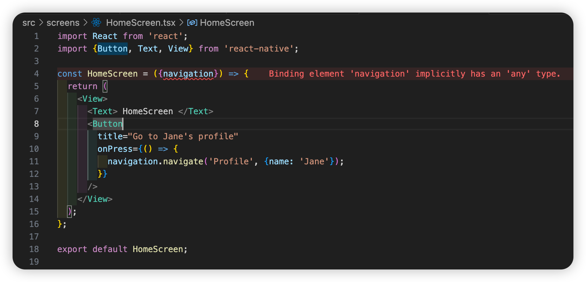
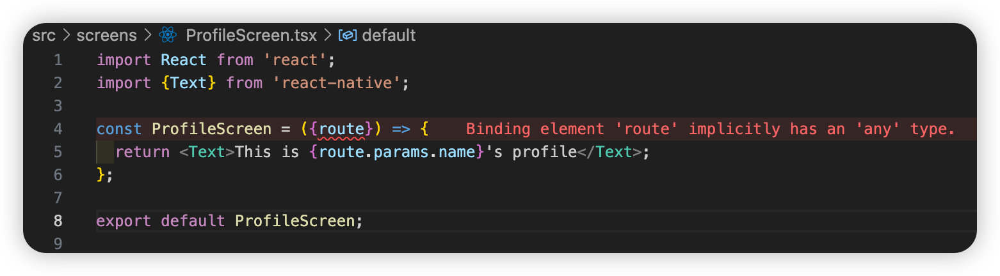
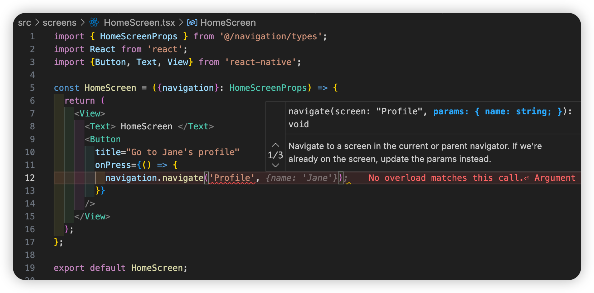
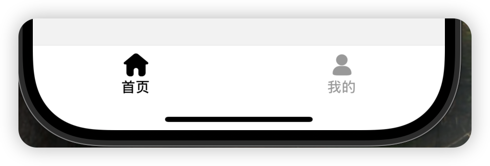
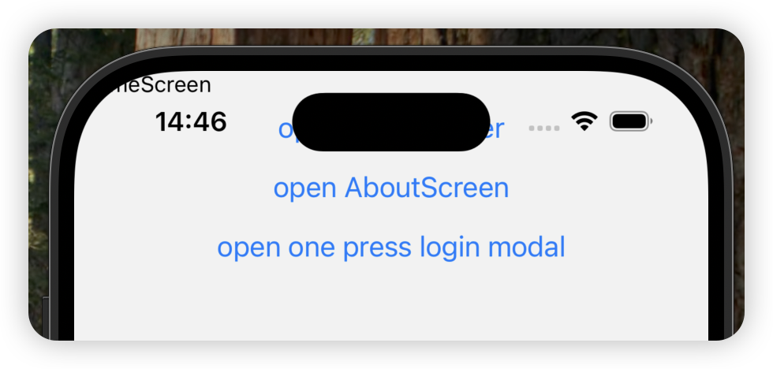
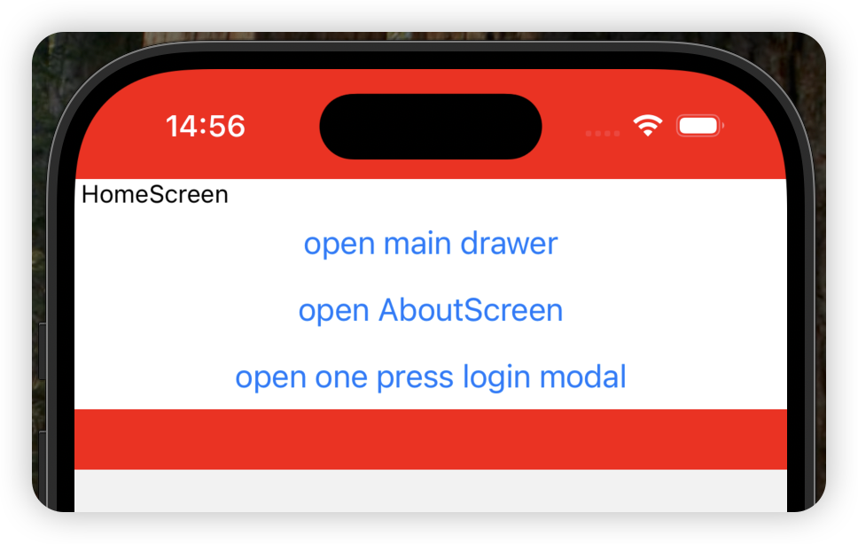
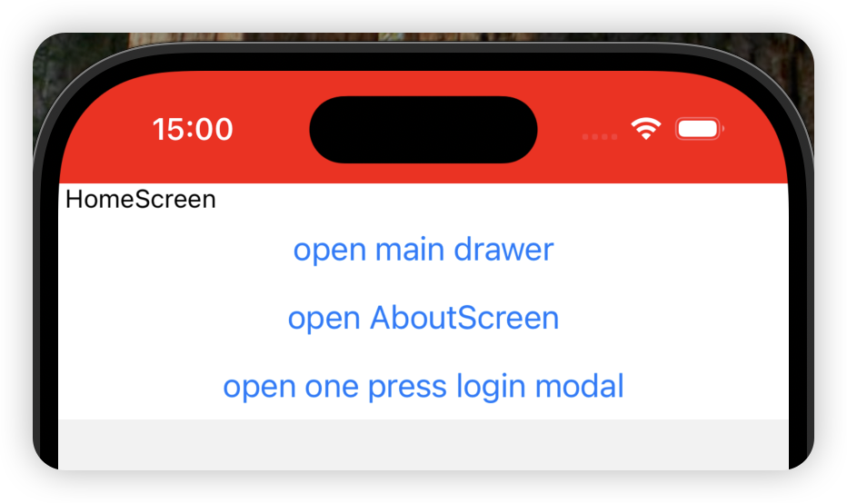

# react-native-template

Plantilla de infraestructura para React Native lista para usar

## Navegación y enrutamiento

[React Navigation](https://reactnavigation.org/docs/getting-started)

### Instale las dependencias requeridas según la documentación oficial de React Native

[https://reactnative.dev/docs/navigation](https://reactnative.dev/docs/navigation)

```bash
yarn add @react-navigation/native @react-navigation/native-stack
```

```bash
yarn add react-native-screens react-native-safe-area-context
```

**Antes de ejecutar en iOS, es necesario ejecutar primero:**

```bash
cd ios
pod install
cd ..
```

### Modifique App.tsx para crear el contenedor de navegación

```tsx
import React from 'react';
import {NavigationContainer} from '@react-navigation/native';
import RootStack from '@/navigation';

function App(): React.JSX.Element {
  return (
    <NavigationContainer>
      <RootStack />
    </NavigationContainer>
  );
}

export default App;
```

Aquí he colocado RootStack en el directorio navigation para facilitar su gestión.

Para usar @ como alias del directorio src, necesita instalar la siguiente dependencia y realizar una configuración.

```bash
yarn add --dev babel-plugin-module-resolver
```

Agregue la siguiente configuración de plugins en el archivo babel.config.js

```javascript
module.exports = {
  presets: ['module:@react-native/babel-preset'],
  plugins: [
    [
      'module-resolver',
      {
        root: ['./src'],
        alias: {
          '@': './src',
        },
      },
    ],
  ],
};
```

Para que VS Code brinde sugerencias amigables, agregue la configuración compilerOptions en el archivo tsconfig.json

```json
{
  "extends": "@react-native/typescript-config/tsconfig.json",
  "compilerOptions": {
    "baseUrl": ".",
    "paths": {
      "@/*": ["src/*"]
    }
  }
}
```

### Continuar con la implementación de RootStack

Cree el módulo navigation y exporte RootStack

```tsx
import React from 'react';
import {createNativeStackNavigator} from '@react-navigation/native-stack';
import HomeScreen from '@/screens/HomeScreen';
import ProfileScreen from '@/screens/ProfileScreen';

const Stack = createNativeStackNavigator();

function RootStack() {
  return (
    <Stack.Navigator>
      <Stack.Screen
        name="Home"
        component={HomeScreen}
        options={{title: 'Welcome'}}
      />
      <Stack.Screen name="Profile" component={ProfileScreen} />
    </Stack.Navigator>
  );
}

export default RootStack;
```

Cree HomeScreen y ProfileScreen

```tsx
import React from 'react';
import {Button, Text, View} from 'react-native';

const HomeScreen = ({navigation}) => {
  return (
    <View>
      <Text> HomeScreen </Text>
      <Button
        title="Go to Jane's profile"
        onPress={() => {
          navigation.navigate('Profile', {name: 'Jane'});
        }}
      />
    </View>
  );
};

export default HomeScreen;
```

```tsx
import React from 'react';
import {Text} from 'react-native';

const ProfileScreen = ({route}) => {
  return <Text>This is {route.params.name}'s profile</Text>;
};

export default ProfileScreen;
```

Ejecute para ver el resultado:

> Si ejecuta en iOS y ha instalado dependencias nativas, debe ejecutar los comandos relacionados con iOS antes de volver a ejecutar.

```bash
npx pod-install
```

O

```bash
cd ios
pod install
cd ..
```

Luego, ejecute el comando de inicio de React Native

```bash
yarn start
```

Se recomienda abrir otra ventana de terminal y ejecutar para iniciar el simulador

```bash
yarn ios
# O
yarn android
```

Resultado final:

<video width="320" height="240" controls>
  <source src="./docs/assets/iShot_2025-02-21_16.13.01.mp4" type="video/mp4">
  Your browser does not support the video tag.
</video>

> Hasta aquí se ha completado la navegación y el enrutamiento más básico en la App.

### Tipos de TS para la navegación

En el ejemplo anterior, se observan errores de tipos de TS en partes del código





A continuación, continuamos mejorando la navegación añadiendo archivos de tipos

Cree type.ts dentro del módulo navigation y exporte el tipo RootStackParamList

```ts
// src/navigation/type.ts
import {NativeStackScreenProps} from '@react-navigation/native-stack';

export type RootStackParamList = {
  Home: undefined;
  Profile: {name: string};
};

export type HomeScreenProps = NativeStackScreenProps<
  RootStackParamList,
  'Home'
>;

export type ProfileScreenProps = NativeStackScreenProps<
  RootStackParamList,
  'Profile'
>;

declare global {
  namespace ReactNavigation {
    /**
     * 全局导航参数列表
     */
    interface RootParamList extends RootStackParamList {}
  }
}
```

Modifique navigation/index.tsx para agregar el tipo RootStackParamList al método createNativeStackNavigator

```ts
const Stack = createNativeStackNavigator<RootStackParamList>();
```

Modifique HomeScreen y ProfileScreen para agregar sus respectivos tipos

```tsx
const HomeScreen = ({navigation}: HomeScreenProps) => {
  ...
};
```

```tsx
const ProfileScreen = ({route}: ProfileScreenProps) => {
  ...
};
```

Ahora ya no hay errores de tipos de TS en las pantallas, y al usar navigation y route del navigador, obtendrá sugerencias de código amigables.



### Navegación por Tabs y Drawer

Por lo general, la página principal de una app incluye navegación inferior por Tabs y navegación Drawer. A continuación, modificaremos el código anterior para convertir HomeScreen y ProfileScreen en páginas de navegación Tabs y añadiremos un Drawer.

Instale las dependencias para la navegación por tabs

```bash
yarn add @react-navigation/bottom-tabs @react-navigation/drawer
```

Para usar @react-navigation/drawer, también necesita instalar las siguientes dependencias adicionales

```bash
yarn add react-native-gesture-handler react-native-reanimated
```

Cree la navegación inferior por Tabs para la página principal

Cree las siguientes páginas y mueva los archivos HomeScreen y ProfileScreen anteriores al directorio HomeTabs

```tsx
// src/screen/HomeTabs/index.tsx
import React from 'react';
import {createBottomTabNavigator} from '@react-navigation/bottom-tabs';
import HomeScreen from './HomeScreen';
import ProfileScreen from './ProfileScreen';
import {HomeTabsParamList} from '@/navigation/types';

const BottomTabNavigator = createBottomTabNavigator<HomeTabsParamList>();

const HomeTabs = () => {
  return (
    <BottomTabNavigator.Navigator initialRouteName="Home">
      <BottomTabNavigator.Screen
        name="Home"
        component={HomeScreen}
        options={{title: '首页'}}
      />
      <BottomTabNavigator.Screen
        name="Profile"
        component={ProfileScreen}
        options={{title: '我的'}}
      />
    </BottomTabNavigator.Navigator>
  );
};

export default HomeTabs;
```

Modifique el nodo raíz de la navegación

```jsx
import React from 'react';
import {createNativeStackNavigator} from '@react-navigation/native-stack';
import {RootStackParamList, RoowDrawerStackParamList} from './types';
import HomeTabs from '../screens/HomeTabs/index';
import {createDrawerNavigator} from '@react-navigation/drawer';
import AboutScreen from '@/screens/Settings/AboutScreen';

const Stack = createNativeStackNavigator<RootStackParamList>();
const RootDrawerStack = createDrawerNavigator<RoowDrawerStackParamList>();

function RootStack() {
  return (
    <Stack.Navigator>
      <Stack.Screen name="HomeTabs" component={HomeTabs} />
      <Stack.Group>
        <Stack.Screen name="About" component={AboutScreen} />
      </Stack.Group>
    </Stack.Navigator>
  );
}

function RootDrawerWrapper() {
  return (
    <RootDrawerStack.Navigator>
      <RootDrawerStack.Screen name="MainDrawer" component={RootStack} />
    </RootDrawerStack.Navigator>
  );
}

export default RootDrawerWrapper;
```

Aquí se añade una nueva página About

```jsx
import {AboutScreenProps} from '@/navigation/types';
import {Text, View, Button} from 'react-native';

const AboutScreen = ({navigation}: AboutScreenProps) => {
  return (
    <View>
      <Text> AboutScreen </Text>

      <Button
        title="open main drawer"
        onPress={() => {
          navigation.openDrawer();
        }}
      />
    </View>
  );
};

export default AboutScreen;
```

Modifique el archivo de tipos de navigation

```ts
import {BottomTabScreenProps} from '@react-navigation/bottom-tabs';
import {DrawerScreenProps} from '@react-navigation/drawer';
import {
  CompositeScreenProps,
  NavigatorScreenParams,
} from '@react-navigation/native';
import {NativeStackScreenProps} from '@react-navigation/native-stack';

/**
 * 根堆栈导航的参数列表类型
 * @typedef RootStackParamList
 * @property {NavigatorScreenParams<HomeTabsParamList>} HomeTabs - 主页标签页导航参数
 * @property {undefined} About - 关于页面
 */
export type RootStackParamList = {
  HomeTabs: NavigatorScreenParams<HomeTabsParamList>;
  About: undefined;
};

/**
 * 根抽屉导航的参数列表类型
 * @typedef RoowDrawerStackParamList
 * @property {undefined} MainDrawer - 主抽屉页面
 */
export type RoowDrawerStackParamList = {
  MainDrawer: undefined;
};

/**
 * 根堆栈屏幕属性类型
 * 组合了原生堆栈导航属性和抽屉导航属性
 * @template T - 根堆栈参数列表中的键
 */
export type RootStackScreenProps<T extends keyof RootStackParamList> =
  CompositeScreenProps<
    NativeStackScreenProps<RootStackParamList, T>,
    DrawerScreenProps<RoowDrawerStackParamList>
  >;

/**
 * 主页标签页导航的参数列表类型
 * @typedef HomeTabsParamList
 * @property {undefined} Home - 主页
 * @property {undefined} Profile - 个人资料页
 */
export type HomeTabsParamList = {
  Home: undefined;
  Profile: undefined;
};

/**
 * 主页屏幕属性类型
 * 组合了底部标签页导航属性和根堆栈导航属性
 */
export type HomeScreenProps = CompositeScreenProps<
  BottomTabScreenProps<HomeTabsParamList, 'Home'>,
  RootStackScreenProps<'HomeTabs'>
>;

/**
 * 个人资料页屏幕属性类型
 * 组合了底部标签页导航属性和根堆栈导航属性
 */
export type ProfileScreenProps = CompositeScreenProps<
  BottomTabScreenProps<HomeTabsParamList, 'Profile'>,
  RootStackScreenProps<'HomeTabs'>
>;

/**
 * 关于页面的屏幕属性类型
 */
export type AboutScreenProps = RootStackScreenProps<'About'>;

declare global {
  namespace ReactNavigation {
    /**
     * 全局导航参数列表
     */
    interface RootParamList extends RootStackParamList {}
  }
}
```

Demostración del resultado tras la ejecución:

<video width="320" height="240" controls>
  <source src="./docs/assets/iShot_2025-02-26_16.43.55.mp4" type="video/mp4">
  Your browser does not support the video tag.
</video>

### Navegación Modal

Ventanas modales en escenarios de negocio, como el popup de inicio de sesión

En react-navigation, la creación de ventanas modales es consistente con la de páginas normales

Solo es necesario establecer la propiedad presentation en screenOptions

```tsx
<Stack.Group screenOptions={{presentation: 'modal'}}>
  <Stack.Screen name="MyModal" component={ModalScreen} />
</Stack.Group>
```

A continuación, crearemos un efecto de modal para el inicio de sesión

```tsx
// screens/Login/OnePressLoginModal.tsx
import {OnePressLoginModalProps} from '@/navigation/types';
import {Button, StyleSheet, TouchableWithoutFeedback, View} from 'react-native';

const OnePressLoginModal = ({navigation}: OnePressLoginModalProps) => {
  return (
    <View style={styles.container}>
      <TouchableWithoutFeedback
        onPress={() => {
          navigation.goBack();
        }}>
        <View style={styles.mask} />
      </TouchableWithoutFeedback>

      <View style={styles.modal}>
        <Button
          title="一键登录"
          onPress={() => {
            console.log('一键登录');
          }}
        />
      </View>
    </View>
  );
};

const styles = StyleSheet.create({
  container: {
    flex: 1,
    justifyContent: 'flex-end',
  },
  mask: {
    ...StyleSheet.absoluteFillObject,
    backgroundColor: 'rgba(0, 0, 0, 0.5)',
  },
  modal: {
    backgroundColor: 'white',
    borderTopLeftRadius: 20,
    borderTopRightRadius: 20,
    padding: 16,
    height: '40%',
    justifyContent: 'center',
    alignItems: 'center',
  },
});

export default OnePressLoginModal;
```

Agregue OnePressLoginModal dentro del navegador de nodos raíz

```tsx
function RootStack() {
  return (
    <Stack.Navigator>
      <Stack.Screen name="HomeTabs" component={HomeTabs} />
      <Stack.Group>
        <Stack.Screen name="About" component={AboutScreen} />
      </Stack.Group>
      <Stack.Group
        screenOptions={{
          presentation: 'transparentModal',
          headerShown: false,
          animation: 'fade_from_bottom',
        }}>
        <Stack.Screen
          name="OnePressLoginModal"
          component={OnePressLoginModal}
          options={{
            contentStyle: {backgroundColor: 'transparent'},
          }}
        />
      </Stack.Group>
    </Stack.Navigator>
  );
}
```

Agregue un botón en la página principal para desencadenar la navegación

```tsx
<Button
  title="open one press login modal"
  onPress={() => {
    navigation.navigate('OnePressLoginModal');
  }}
/>
```

Resultado final:

<video width="320" height="240" controls>
  <source src="./docs/assets/iShot_2025-02-26_17.45.14.mp4" type="video/mp4">
  Your browser does not support the video tag.
</video>

Fin de la sección de navegación

## Embellecer la navegación

### Uso de la biblioteca de iconos iconfont para añadir iconos a la navegación inferior por tabs

Instale las dependencias necesarias:

```bash
yarn add react-native-svg
```

Herramienta de conversión de iconos:

```bash
yarn add -D react-native-iconfont-cli-2
```

react-native-iconfont-cli-2 es un fork que hice de [react-native-iconfont-cli](https://github.com/iconfont-cli/react-native-iconfont-cli) con modificaciones

Parece que react-native-iconfont-cli ya no se mantiene y la versión actual presenta errores con defaultProps

Por lo tanto, hice un fork, lo corregí y lo publiqué como [react-native-iconfont-cli-2](https://github.com/ace0109/react-native-iconfont-cli)

La inicialización y el uso son consistentes con react-native-iconfont-cli.

### Modificar iconos y estilos de la navegación inferior por tabs

Modifique el código de HomeTabs en el código anterior, agregando el parámetro screenOptions

```tsx
import {createBottomTabNavigator} from '@react-navigation/bottom-tabs';
import HomeScreen from './HomeScreen';
import ProfileScreen from './ProfileScreen';
import {HomeTabsParamList} from '@/navigation/types';
import {RouteProp} from '@react-navigation/native';
import {IconHome, IconProfile} from '@/components/Iconfont';

const BottomTabNavigator = createBottomTabNavigator<HomeTabsParamList>();

const HomeTabs = () => {
  return (
    <BottomTabNavigator.Navigator
      initialRouteName="Home"
      screenOptions={({route}) => {
        return {
          headerShown: false, // 隐藏头部
          tabBarActiveTintColor: '#000', // 选中颜色
          tabBarInactiveTintColor: '#999', // 未选中颜色
          tabBarActiveBackgroundColor: '#fff', // 选中背景色
          tabBarInactiveBackgroundColor: '#fff', // 未选中背景色
          tabBarLabelStyle: {
            fontSize: 14,
          },
          tabBarIcon: getTabBarIcon(route),
        };
      }}>
      <BottomTabNavigator.Screen
        name="Home"
        component={HomeScreen}
        options={{title: '首页'}}
      />
      <BottomTabNavigator.Screen
        name="Profile"
        component={ProfileScreen}
        options={{title: '我的'}}
      />
    </BottomTabNavigator.Navigator>
  );
};

const getTabBarIcon =
  (route: RouteProp<HomeTabsParamList, keyof HomeTabsParamList>) =>
  (props: {focused: boolean; color: string; size: number}) => {
    switch (route.name) {
      case 'Home':
        return <IconHome color={props.color} size={24} />;
      case 'Profile':
        return <IconProfile color={props.color} size={24} />;
      default:
        return null;
    }
  };

export default HomeTabs;
```

Resultado:



### Optimización para pantallas con notch y la barra blanca inferior

Cuando configuramos headerShown: false en screenOptions



Necesitamos aplicar ajustes de compatibilidad a las páginas

Ya instalamos las dependencias necesarias anteriormente:

[react-native-safe-area-context](https://appandflow.github.io/react-native-safe-area-context/)

Primero, agregue una capa SafeAreaProvider a app.tsx

```tsx
import React from 'react';
import {NavigationContainer} from '@react-navigation/native';
import RootStack from '@/navigation';
import {SafeAreaProvider} from 'react-native-safe-area-context';

function App(): React.JSX.Element {
  return (
    <SafeAreaProvider>
      <NavigationContainer>
        <RootStack />
      </NavigationContainer>
    </SafeAreaProvider>
  );
}

export default App;
```

Luego, en las páginas que requieren compatibilidad, agregue una capa SafeAreaView

```tsx
import {HomeScreenProps} from '@/navigation/types';
import {Button, StyleSheet, Text, View} from 'react-native';
import {SafeAreaView} from 'react-native-safe-area-context';

const HomeScreen = ({navigation}: HomeScreenProps) => {
  return (
    <SafeAreaView style={styles.container}>
      <View style={styles.content}>
        <Text> HomeScreen </Text>
        <Button
          title="open main drawer"
          onPress={() => {
            navigation.openDrawer();
          }}
        />

        <Button
          title="open AboutScreen"
          onPress={() => {
            navigation.navigate('About');
          }}
        />

        <Button
          title="open one press login modal"
          onPress={() => {
            navigation.navigate('OnePressLoginModal');
          }}
        />
      </View>
    </SafeAreaView>
  );
};

const styles = StyleSheet.create({
  container: {
    backgroundColor: 'red',
  },
  content: {
    backgroundColor: '#fff',
  },
});

export default HomeScreen;
```

Ahora observe el resultado de la página principal:



Al agregar un fondo al contenedor, podemos ver que se han aplicado márgenes por defecto en la parte superior e inferior

Por defecto se usa padding, pero también se puede cambiar a margin mediante el parámetro mode

En las páginas de tab, la parte inferior ya está gestionada por tabBar, por lo que nuestro contenedor no necesita gestionar el espacio inferior

Use el parámetro edges para controlar las direcciones necesarias

```tsx
<SafeAreaView style={styles.container} edges={['top']}>
```

Resultado:



## Adaptación de tamaño de pantalla

En el desarrollo web, usamos px2rem o px2viewport para adaptar diferentes tamaños de pantalla.

En React Native, puede usar [react-native-size-matters](https://github.com/nirsky/react-native-size-matters)

Instale las dependencias:

```bash
yarn add react-native-size-matters
```

Las dimensiones de conversión predeterminadas son 350dp x 680dp. Podemos cambiar las dimensiones de conversión mediante configuración. Supongamos que el diseño de UI es de 390.

Instale las dependencias:

```bash
yarn add -D babel-plugin-dotenv-import
```

Modifique babel.config.js y agregue la configuración dotenv-import en plugins

```js
module.exports = {
  presets: ['module:@react-native/babel-preset'],
  plugins: [
    [
      'module-resolver',
      {
        root: ['./src'],
        alias: {
          '@': './src',
        },
      },
    ],
    'react-native-reanimated/plugin',
    [
      'dotenv-import',
      {
        moduleName: '@env',
        path: '.env',
      },
    ],
  ],
};
```

Cree un archivo .env en el directorio raíz

```
SIZE_MATTERS_BASE_WIDTH=390
SIZE_MATTERS_BASE_HEIGHT=844
```

Cree el directorio de tipos globales types y un archivo env.d.ts para facilitar las sugerencias de tipos cuando se agreguen nuevas variables de entorno.

```ts
declare module '@env' {
  export const SIZE_MATTERS_BASE_WIDTH: number;
  export const SIZE_MATTERS_BASE_HEIGHT: number;
}
```

Intente imprimir las variables de entorno en la página; si se leen correctamente, está listo.

```tsx
import {SIZE_MATTERS_BASE_WIDTH, SIZE_MATTERS_BASE_HEIGHT} from '@env';

...
<Text> SIZE_MATTERS_BASE_WIDTH: {SIZE_MATTERS_BASE_WIDTH} </Text>
<Text> SIZE_MATTERS_BASE_HEIGHT: {SIZE_MATTERS_BASE_HEIGHT} </Text>
...
```

Después de usar dimensiones personalizadas, necesita importar los métodos desde react-native-size-matters/extend

```ts
import {ScaledSheet} from 'react-native-size-matters/extend';
```

Modifique el ejemplo de uso en la página principal:

```tsx
import {HomeScreenProps} from '@/navigation/types';
import {Button, Text, View} from 'react-native';
import {SafeAreaView} from 'react-native-safe-area-context';
import {API_URL} from '@env';
import {scale, ScaledSheet} from 'react-native-size-matters/extend';

const HomeScreen = ({navigation}: HomeScreenProps) => {
  return (
    <SafeAreaView style={styles.container} edges={['top']}>
      <View style={styles.content}>
        <Text style={{fontSize: scale(16)}}> HomeScreen {API_URL} </Text>
        <Button
          title="open main drawer"
          onPress={() => {
            navigation.openDrawer();
          }}
        />

        <Button
          title="open AboutScreen"
          onPress={() => {
            navigation.navigate('About');
          }}
        />

        <Button
          title="open one press login modal"
          onPress={() => {
            navigation.navigate('OnePressLoginModal');
          }}
        />
      </View>
    </SafeAreaView>
  );
};

const styles = ScaledSheet.create({
  container: {
    backgroundColor: 'red',
  },
  content: {
    backgroundColor: '#fff',
    fontSize: '20@s',
  },
});

export default HomeScreen;
```

## Caché local

[react-native-mmkv](https://github.com/mrousavy/react-native-mmkv)

```bash
yarn add react-native-mmkv
```

Uso

```ts
import {MMKV, Mode} from 'react-native-mmkv';

export const storage = new MMKV({
  id: `user-${userId}-storage`,
  path: `${USER_DIRECTORY}/storage`,
  encryptionKey: 'hunter2',
  mode: Mode.MULTI_PROCESS,
  readOnly: false,
});
```

Crearemos un módulo storage para gestionar el caché local

```ts
// src/storage/modules/userStorage.ts
import {MMKV} from 'react-native-mmkv';
import {ENCRYPTION_KEY} from '@env';

export const userStorage = new MMKV({
  id: 'user-storage',
  encryptionKey: ENCRYPTION_KEY,
});
```

Cree un archivo de entrada para exportar

```ts
// src/storage/index.ts
export * from './modules/userStorage';
```

Modifique la página principal para ver el resultado:

```tsx
import {HomeScreenProps} from '@/navigation/types';
import {Button, Text, View} from 'react-native';
import {SafeAreaView} from 'react-native-safe-area-context';
import {API_URL} from '@env';
import {scale, ScaledSheet} from 'react-native-size-matters/extend';
import {userStorage} from '@/storage';
import {useMMKVString} from 'react-native-mmkv';

const HomeScreen = ({}: HomeScreenProps) => {
  // const token = userStorage.getString('token');
  const [token, setToken] = useMMKVString('token', userStorage);

  return (
    <SafeAreaView style={styles.container} edges={['top']}>
      <View style={styles.content}>
        <Text style={{fontSize: scale(16)}}> HomeScreen {API_URL} </Text>
        <Button
          title="set user token"
          onPress={() => {
            // userStorage.set('token', '123456');
            setToken('6789');
          }}
        />

        <Text>token: {token || '-'}</Text>
      </View>
    </SafeAreaView>
  );
};

const styles = ScaledSheet.create({
  container: {
    backgroundColor: 'red',
  },
  content: {
    backgroundColor: '#fff',
    fontSize: '20@s',
  },
});

export default HomeScreen;
```

## Gestión de estado global [zustand](https://github.com/pmndrs/zustand)

```bash
yarn add zustand
```

Combine la gestión de estado global zustand con el caché local react-native-mmkv para lograr la persistencia de estado.

Cree los siguientes archivos:

```ts
import {userStorage} from '@/storage/index';
import {create} from 'zustand';
import {persist, createJSONStorage} from 'zustand/middleware';

interface UserInfo {
  userId: string;
  username: string;
}

interface UserState {
  userInfo: UserInfo | null;
  token: string | null;
  setUserInfo: (userInfo: UserInfo) => void;
  setToken: (token: string) => void;
}

export const userStore = create<UserState>()(
  persist(
    set => ({
      userInfo: null,
      token: null,
      setUserInfo: (userInfo: UserInfo) => {
        set(() => {
          return {
            userInfo,
          };
        });
      },
      setToken: token =>
        set(() => {
          return {
            token,
          };
        }),
    }),
    {
      name: 'user-storage',
      storage: createJSONStorage(() => ({
        setItem: (key: string, value: any) => {
          return userStorage.set(key, value);
        },
        getItem: (key: string) => {
          const value = userStorage.getString(key);
          return value ?? null;
        },
        removeItem: (key: string) => {
          return userStorage.delete(key);
        },
      })),
    },
  ),
);
```

Modifique la página principal para demostrar el resultado

```tsx
import {HomeScreenProps} from '@/navigation/types';
import {Button, Text, View} from 'react-native';
import {SafeAreaView} from 'react-native-safe-area-context';
import {API_URL} from '@env';
import {scale, ScaledSheet} from 'react-native-size-matters/extend';
import {userStore} from '@/store';

const HomeScreen = ({}: HomeScreenProps) => {
  const {userInfo, setUserInfo, token, setToken} = userStore();

  return (
    <SafeAreaView style={styles.container} edges={['top']}>
      <View style={styles.content}>
        <Text style={{fontSize: scale(16)}}> HomeScreen {API_URL} </Text>
        <Button
          title="set user token"
          onPress={() => {
            // userStorage.set('token', '123456');
            setToken('6789');
          }}
        />

        <Text>token: {token || '-'}</Text>

        <Button
          title="set user info"
          onPress={() => {
            const randomId = Math.random().toString(36).substring(2, 11);
            const names = [
              'Alice',
              'Bob',
              'Charlie',
              'David',
              'Eva',
              'Frank',
              'Grace',
            ];
            const randomName = names[Math.floor(Math.random() * names.length)];
            setUserInfo({userId: randomId, username: randomName});
          }}
        />

        <Text>user id: {userInfo?.userId || '-'}</Text>
        <Text>user name: {userInfo?.username || '-'}</Text>
      </View>
    </SafeAreaView>
  );
};

const styles = ScaledSheet.create({
  container: {
    backgroundColor: 'red',
  },
  content: {
    backgroundColor: '#fff',
    fontSize: '20@s',
  },
});

export default HomeScreen;
```

## Alternativa a useState [jotai](https://github.com/pmndrs/jotai)

jotai puede usarse para la gestión de estado global, pero yo solo lo uso para reemplazar useState.

¿Por qué elegir jotai? Principalmente por 3 razones:

1. Similar a computed de Vue
2. Actualización asíncrona
3. Actualización de objetos en niveles profundos

- computed

```tsx
import {HomeScreenProps} from '@/navigation/types';
import {Button, Text, View} from 'react-native';
import {SafeAreaView} from 'react-native-safe-area-context';
import {ScaledSheet} from 'react-native-size-matters/extend';
import {atom, useAtom} from 'jotai';

const countAtom = atom(0);
const doubledCountAtom = atom(get => get(countAtom) * 2);

const HomeScreen = ({navigation}: HomeScreenProps) => {
  const [count, setCount] = useAtom(countAtom);
  const [doubledCount] = useAtom(doubledCountAtom);

  return (
    <SafeAreaView style={styles.container} edges={['top']}>
      <View style={styles.content}>
        <Text>count: {count}</Text>
        <Text>doubled count: {doubledCount}</Text>
        <Button title="one up" onPress={() => setCount(c => c + 1)} />

        <Button
          title="open about"
          onPress={() => navigation.navigate('About')}
        />
      </View>
    </SafeAreaView>
  );
};

const styles = ScaledSheet.create({
  container: {
    backgroundColor: 'red',
  },
  content: {
    backgroundColor: '#fff',
    fontSize: '20@s',
  },
});

export default HomeScreen;
```

- Actualización asíncrona

```tsx
import {HomeScreenProps} from '@/navigation/types';
import {Button, Text, View} from 'react-native';
import {SafeAreaView} from 'react-native-safe-area-context';
import {ScaledSheet} from 'react-native-size-matters/extend';
import {atom, useAtom} from 'jotai';
import {Suspense} from 'react';

const countAtom = atom(0);
const asyncAtom = atom(async get => {
  return new Promise<number>(resolve => {
    setTimeout(() => {
      resolve(get(countAtom) * 2);
    }, 1000);
  });
});

function AsyncAtomComponent() {
  const [asyncValue] = useAtom(asyncAtom);

  return (
    <>
      <Text>async count: {asyncValue}</Text>
    </>
  );
}

const HomeScreen = ({navigation}: HomeScreenProps) => {
  const [count, setCount] = useAtom(countAtom);

  return (
    <SafeAreaView style={styles.container} edges={['top']}>
      <View style={styles.content}>
        <Text>count: {count}</Text>
        <Suspense fallback={<Text>Loading...</Text>}>
          <AsyncAtomComponent />
        </Suspense>
        <Button title="one up" onPress={() => setCount(c => c + 1)} />

        <Button
          title="open about"
          onPress={() => navigation.navigate('About')}
        />
      </View>
    </SafeAreaView>
  );
};

const styles = ScaledSheet.create({
  container: {
    backgroundColor: 'red',
  },
  content: {
    backgroundColor: '#fff',
    fontSize: '20@s',
  },
});

export default HomeScreen;
```

- Actualización de objetos en niveles profundos

Es necesario instalar 2 dependencias adicionales:

```bash
yarn add immer jotai-immer
```

```tsx
import {HomeScreenProps} from '@/navigation/types';
import {Button, Text, View} from 'react-native';
import {SafeAreaView} from 'react-native-safe-area-context';
import {ScaledSheet} from 'react-native-size-matters/extend';
import {useAtom} from 'jotai';
import {atomWithImmer} from 'jotai-immer';

const userAtom = atomWithImmer({
  name: 'John',
  profile: {
    address: {
      city: 'Shanghai',
    },
  },
});

const HomeScreen = ({}: HomeScreenProps) => {
  const [user, setUser] = useAtom(userAtom);

  return (
    <SafeAreaView style={styles.container} edges={['top']}>
      <View style={styles.content}>
        <Text>{JSON.stringify(user)}</Text>

        <Button
          title="updateUser"
          onPress={() => {
            setUser(draft => {
              draft.name = 'Lai';
              draft.profile.address.city = 'Beijing';
            });

            // 如果是useState的话
            // setUser(prevState => {
            //   return {
            //     ...prevState,
            //     profile: {
            //       ...prevState.profile,
            //       address: {
            //         ...prevState.profile.address,
            //         city: newCity,
            //       },
            //     },
            //   };
            // });
          }}
        />
      </View>
    </SafeAreaView>
  );
};

const styles = ScaledSheet.create({
  container: {
    backgroundColor: 'red',
  },
  content: {
    backgroundColor: '#fff',
    fontSize: '20@s',
  },
});

export default HomeScreen;
```
